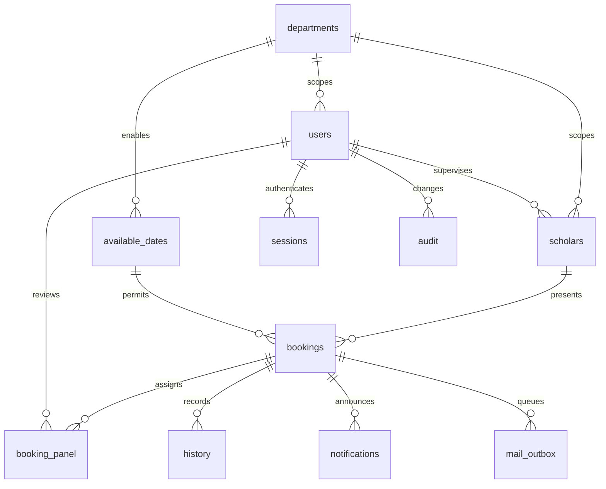

# Architecture and security model

## Stack

Node 24.14.1, Express 5, built-in `node:sqlite`, Zod 4, Helmet, Nodemailer 10; standards-based HTML/CSS/browser modules. The exact resolved dependencies are recorded in `package-lock.json`. Node's SQLite API on the tested version is experimental and emits a warning.

This is a small, coherent same-origin application. A frontend framework/build chain adds little to the booking workflow, so the browser uses modular DOM construction. It creates text nodes for all API/user content; no `innerHTML`, inline event handlers, remote scripts or dynamic code evaluation are used. Browser state is not an authorization source.

## Data model



UUIDs identify resources. Every staff account belongs to one department. Foreign-department records are not visible to normal staff or admins. A request's supervisor, scholar, details and assigned panel remain fixed. Mappings cannot be changed while a scholar has a live request. Account deactivation revokes sessions, preserves history and is blocked for active assigned participants.

## The concurrency guarantee

```sql
CREATE UNIQUE INDEX one_live_booking_per_department_day
ON bookings(department_id,date)
WHERE status IN ('pending_coordinator','pending_hod','approved');
```

A second partial unique index limits each scholar to one live request. These are database constraints, not calendar calculations. `BEGIN IMMEDIATE` covers availability checks, insertion, panel assignment, history and audit writes. Final review updates status, history, audit, notifications and outbox in one transaction. A stale `version` receives HTTP 409. Invalid role/stage decisions receive 403. An inaccessible resource receives 404 to avoid confirming its existence.

SQLite WAL with a ten-second busy timeout is suitable for this departmental workload on a single host. The tests race two **separate Node processes** against the same file. Independently copied SQLite files or a network filesystem do not preserve this deployment model; use a single durable host/database, or migrate the same invariant to a managed database.

## Authentication and request controls

- Scrypt (N=32768, r=8, p=1), 16-byte salt, 64-byte hash; asynchronous password checks; constant-time hash comparison; dummy verification for unknown email.
- 32-byte random session token in HttpOnly/SameSite=Strict cookie, SHA-256 digest in DB, eight-hour absolute expiry. `Secure` cookies in production. Logout and disabled accounts invalidate sessions.
- Separate 32-byte session CSRF token required in a header for authenticated mutations. Every mutating API request also requires the configured exact Origin, including login. No wildcard CORS is enabled.
- Persistent throttle: ten attempts per email and forty per socket IP in fifteen minutes. Successful login clears the email bucket, not the IP bucket. Reverse-proxy IP trust is deliberately not guessed.
- Strict schemas reject unexpected properties; 32 KB JSON body limit; validated dates/times; email normalization; only parameterized SQL.
- CSP restricts script/style/font/connect to self, denies objects and framing; safe error responses do not include stack traces or secrets. Helmet supplies further browser headers.
- Production refuses demo users and an HTTP origin. No production keys/accounts/secrets are supplied.

The session status endpoint returns an anonymous status without a spurious 401 on the login screen. Protected data endpoints still require authentication.

## Browser tools and preferences

`public/enhancements.js` provides theme controls, consent preferences, local campaign attribution, clipboard recovery, printing, contact/help, scroll progress and request feedback. `public/preferences.js` owns the bounded campaign parser and storage policy. `public/theme.js` restores an explicit theme choice before styles render; the default remains institutional light. `public/error-page.js` wires the shared public tools into the server-rendered 404 page.

Portal-wide search reads only the authenticated bootstrap dataset and the current role's allowed navigation. It does not introduce an unscoped search endpoint. The backend continues to authorize every detail request. Copy and print operate on an already authorized detail response.

Theme and optional-consent choices use local storage; optional first-touch UTM records use tab-scoped session storage after consent. Attribution is not persisted in SQLite or sent to an analytics integration. Withdrawing consent deletes the local campaign record. Authentication cookies remain separate and are inaccessible to JavaScript. All frontend fonts and assets are served locally under the existing self-only CSP.

## Notifications

Only final approval and cancellation of a confirmed request create notifications. The transaction snapshots the subject, body and recipient addresses into durable records. The unique booking/recipient/kind constraint prevents duplicate outbox records. Scholar records without login accounts still get email. Non-manager staff can view only their own email records; department coordinator/admin can inspect department delivery records.

The worker claims a sixty-second lease in a transaction, sends outside that transaction, then records capture/success. Failures return to pending with exponential backoff (up to one hour). Expired leases can be recovered. Message IDs are stable. SMTP is at-least-once; provider receipt after a crash cannot be atomically committed with SQLite. Capture mode is explicitly labeled and never claims delivery.

## Important operating limitations

This is a locally verified implementation, not an independently audited production installation. It requires deployment-specific TLS, restricted filesystem access, backup/restore, monitoring, provider configuration and institutional account lifecycle. No MFA, SSO or password-recovery system is simulated. The seeded demo identities and visible demo credentials must not be used for a real institution. UI notifications refresh on navigation/reload; no WebSocket/push service is required. Administrative audit records are application-enforced history, not a tamper-proof external log against a database administrator.

## Primary engineering references

- [Node SQLite API](https://nodejs.org/api/sqlite.html) — synchronous prepared-statement interface; tested against the installed Node 24 runtime.
- [SQLite unique partial indexes](https://www.sqlite.org/partialindex.html) — database-level conditional uniqueness.
- [Express production security](https://expressjs.com/en/advanced/best-practice-security/) — input handling, cookies, headers and dependency hygiene.
- [OWASP session management](https://cheatsheetseries.owasp.org/cheatsheets/Session_Management_Cheat_Sheet.html) — session entropy, cookie controls and lifecycle.

