# Requirement traceability and assumptions

Source reviewed: the five-page uploaded **venue project.pdf**, recovered from the referenced ChatGPT conversation on 21 October 2026. It is an informal transcript with repetitions and conflicting proposals; the explicit current user request takes precedence. No database, server account or domain credentials were supplied, and none were fabricated.

| Transcript evidence | Implemented behavior |
|---|---|
| Page 1: departmental pre-talk is an open forum; one pre-talk for the whole department per day | One active department/day reservation, regardless of venue/time; open forum content; no academic eligibility engine |
| Page 2: supervisors book the day for scholars; venue is entered manually | Supervisor booking form, mapped-scholar selection, free-text venue and manually selected time |
| Page 3: coordinator maintains people; faculty ID and name; supervisor has scholar dropdown | Coordinator/admin account provisioning, faculty IDs, scholar directory and mapping |
| Page 4: coordinator includes/excludes available calendar dates; login with mail ID; panel can check pending dates | Date calendar, email/password login, panel read-only access to assigned pending and confirmed requests |
| Page 5: coordinator approval followed by HOD approval; mail after both to panel and supervisor | Server-enforced sequential state machine and transactional final-notification outbox |

## Decisions where the transcript is incomplete

1. **Separate privileges.** Although page 5 briefly proposes identical HOD/coordinator access, the application uses least privilege: coordinator manages the department and gives first approval; HOD performs final review in a separate login. An admin has coordinator privileges plus coordinator provisioning, not HOD bypass.
2. **Reservation timing.** A submitted request reserves the whole day immediately, through coordinator and HOD review. Waiting until final approval would allow conflicting pending requests.
3. **Rejection.** Either authorized reviewer may reject at their own stage with a reason of at least five characters. The day and scholar reservation are released; history is retained. A new request starts at coordinator review. No notifications are sent as final confirmations for rejected pending requests; the supervisor sees status/history in the app.
4. **Withdrawal/cancellation.** Supervisor may withdraw a pending request. Coordinator/admin may cancel a pending or confirmed future request. Confirmed cancellations notify the original participants. No hard deletion of bookings is exposed.
5. **Editing.** Submitted requests cannot be edited. Cancellation and rebooking prevents an approval applying to unseen venue/time/panel changes.
6. **Scholar mapping.** Coordinator/admin verifies and maintains scholar details, resolving page 4's conflicting suggestions of supervisor input versus coordinator verification. One supervisor per scholar. Active requests prevent remapping. One live request per scholar is an additional safeguard.
7. **Faculty roles.** An account has one role in one department; users needing separate responsibilities require separately provisioned accounts. Admin scope is departmental, not unrestricted cross-department administration. Multi-role/SO-D conflict policies are a deployment decision.
8. **Panel count.** At least one panel member must be assigned; all four fictional panel members are selected by default. The transcript's usual four-to-five members is guidance rather than a hard minimum. Inactive or foreign-department accounts cannot be assigned.
9. **Scholars.** Optional read-only scholar login is included in the demo. Normal scholar records need only name, registration ID, email, supervisor and optional research area. A scholar record does not create credentials automatically. Unlinked scholars still receive final email notices.
10. **Notification recipients.** Final approval goes to the supervisor, scholar, assigned panel, and departmental HOD, deduplicated by email. In-app notifications are available to those with accounts. Additional faculty/public attendees are not mass-emailed; the HOD may circulate the schedule outside this system if desired.
11. **Time.** All schedule dates/times are Asia/Kolkata (IST). Only future dates may be enabled or booked; reviews must happen before the scheduled day. Current-day cancellations are allowed to release a missed day; past cancellations are blocked. Venue/time are descriptive, not room-availability guarantees. No duration is enforced.
12. **Enabled dates.** There is no assumed weekday-only rule: the coordinator can enable any future day, including a weekend. A reserved day cannot be disabled until its request is cancelled. Availability shows that a day is reserved to other supervisors without disclosing the other scholar's research details.
13. **Lifecycle.** Confirmed requests remain historical approved records after the day passes. No completion/attendance/evaluation module is invented. Past confirmed records do not appear in the upcoming metric, but still prevent a second active request for that scholar until a future lifecycle extension is agreed. This is a documented limitation for repeated milestones.
14. **Security/account lifecycle.** No self-registration; admin/coordinator provisions approved faculty. Initial passwords are given through an institution-approved secure channel. Password recovery, rotation UI, SSO/MFA and email verification are deployment extensions, not simulated flows.
15. **Scope.** Coursework, confirmation meetings, publication counts, synopsis, thesis submission, room inventory, payment, academic assessment and automatic admission decisions are outside the requested scheduling workflow.

## State machine

```mermaid
stateDiagram-v2
    [*] --> pending_coordinator: Supervisor submits and reserves department day
    pending_coordinator --> pending_hod: Coordinator or admin approves
    pending_hod --> approved: HOD approves; queue notifications
    pending_coordinator --> rejected: Coordinator or admin rejects with reason
    pending_hod --> rejected: HOD rejects with reason
    pending_coordinator --> cancelled: Owner supervisor or coordinator cancels
    pending_hod --> cancelled: Owner supervisor or coordinator cancels
    approved --> cancelled: Coordinator cancels; queue cancellation updates
    rejected --> [*]: Day released; history retained
    cancelled --> [*]: Day released; history retained
```

